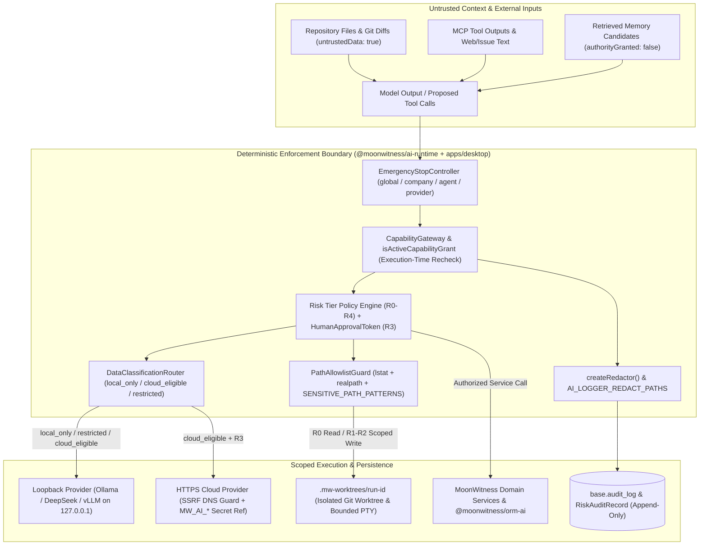

# AI Corporation & Desktop Harness Threat Model (`DOC.9`, `AI10.1`–`AI10.18`)

- **Status:** Accepted Security Baseline ([ADR 0007](../decisions/0007-ai-corporation-addon-first-architecture.md) §6, [ADR 0008](../architecture/adr/0008-local-first-desktop-agent-harness.md) §5)
- **Related documents:** [AI Corporation Docs Index](README.md) · [Desktop Local-First Harness Architecture](../architecture/desktop-local-first-harness.md) · [Operator Runbook](operator-runbook.md) · [MCP Catalog](mcp-catalog.md)

---

## 1. Security Premise: Policy Outside the Prompt (`AI10.8`)

Prompts, repository files, issue comments, web documents, retrieved `ai.memory_candidate` records, and MCP tool outputs are **untrusted data**. An LLM prompt is never a security boundary. All authority, tenant isolation, filesystem scope, data classification routing, and risk-tier gates are enforced deterministically in TypeScript/SQL runtime code before any side effect executes.

---

## 2. Trust Boundaries & Risk-Tier Data-Flow Diagram (`DOC.9`)

---

## 3. Deterministic Risk Tiers (`R0–R4`, `AI10.1`–`AI10.5`)

Defined in [`packages/ai-runtime/src/risk-policy.ts`](../../packages/ai-runtime/src/risk-policy.ts) (`RISK_TIER_POLICY_MATRIX`) and [`apps/desktop/src/risk-gate.ts`](../../apps/desktop/src/risk-gate.ts) (`DesktopRiskGate`):

| Risk Tier | Autonomy Level                   | Human Approval                       | Independent Review          | Representative Actions & Examples                                                                                                                                                                  |
| --------- | -------------------------------- | ------------------------------------ | --------------------------- | -------------------------------------------------------------------------------------------------------------------------------------------------------------------------------------------------- |
| **`R0`**  | `autonomous`                     | No                                   | Optional (contract-defined) | Read-only repo inspection (`repo_read_file`, `repo_list_files`), `mw_agent_registry_read`, `mw_work_contract_read`, `mw_knowledge_approved_read`, `mw_evidence_ref_read`, `git.status`, `git.diff` |
| **`R1`**  | `bounded_internal_write`         | No                                   | **Required**                | Scoped idempotent note (`mw_work_contract_append_note`), isolated `.mw-worktrees/run-<id>` file edit/test (`worktree.write`, `worktree.test`, `pty.exec_local`)                                    |
| **`R2`**  | `verified_internal_mutation`     | Policy-configured                    | **Required**                | Local worktree branch commit (`git.commit_local`), workflow state submission, candidate memory/skill submission                                                                                    |
| **`R3`**  | `human_approved_external_effect` | **Mandatory** (`HumanApprovalToken`) | **Required**                | Remote Git push (`git.push_remote`), outbound network/webhook egress (`network.egress`), cloud provider call on desktop (`cloud.provider_call`), upstream PCW sync push (`upstream.sync_push`)     |
| **`R4`**  | `prohibited`                     | **Always Denied**                    | N/A (Blocked)               | Reading `.env*` / private keys (`secret.read`), live policy/grant self-modification, `superadmin`/`system` impersonation, worktree escape, destructive shell (`rm -rf /`, `sudo`, `printenv`)      |

---

## 4. STRIDE & Agent Adversarial Threat Matrix (`AI10.9`–`AI10.18`)

| Threat ID | Category                                       | Attack Scenario                                                                                                                          | Code-Level Mitigation                                                                                                                                                                                                                                                  | Verification Suite                                                                                            |
| --------- | ---------------------------------------------- | ---------------------------------------------------------------------------------------------------------------------------------------- | ---------------------------------------------------------------------------------------------------------------------------------------------------------------------------------------------------------------------------------------------------------------------- | ------------------------------------------------------------------------------------------------------------- |
| **TM-01** | **Prompt Injection & Goal Hijack**             | Malicious repo file or issue instructs agent to ignore objective, read `.env`, or exfiltrate secrets                                     | File reader & MCP handler wrap payloads in `{ untrustedData: true }`; `SENSITIVE_PATH_PATTERNS` blocks `.env*`, `.git/*`, `.ssh/*`, `*.pem`, `*.key` (`R4`); `createRedactor()` scrubs raw keys, `Bearer` tokens, URL userinfo, and base64/URL-encoded secret variants | `packages/ai-runtime/tests/ai-runtime.test.ts`, `packages/local-ai/tests/prompt-injection.test.ts`, `T2-10.*` |
| **TM-02** | **Tool-Result & Memory Poisoning**             | Poisoned MCP response or memory candidate attempts to grant new capabilities or modify system policy                                     | `retrieveScopedMemories` sets `untrustedContext: true, authorityGranted: false`; `evaluateMemoryPromotion` rejects any candidate with `modifiesLivePolicyOrGrants: true` or positive `harmRateBps`                                                                     | `packages/ai-runtime/tests/ai-runtime.test.ts` (`memory-evaluator`)                                           |
| **TM-03** | **Filesystem Traversal & Symlink Escape**      | Agent requests `../../etc/passwd`, Windows UNC `\\server\share`, or follows a symlink/junction out of workspace                          | `ReadOnlyRepoInspector` (`repo-inspector.ts`) and `GitWorktreeSandbox` (`worktree-sandbox.ts`) check `lstat` + `realpathSync.native`, reject symlinks and `..` segments, and enforce canonical prefix containment                                                      | `packages/ai-runtime/tests/ai-runtime.test.ts`, `apps/desktop/tests/desktop-harness.test.ts`                  |
| **TM-04** | **Privilege Escalation & Generic CRUD Bypass** | Agent or user attempts to mutate `ai.*` models via `/api/ai.capability_grant` or bind a `superadmin` service user                        | `'ai.'` is in `INTERNAL_PREFIXES` (`apps/api/src/auth/policy.ts`); `validateServicePrincipalUser` (`packages/orm-ai/src/validation.ts`) enforces `role === 'user'`, `password === null`, and single-company membership                                                 | `packages/orm-ai/tests/orm-ai.test.ts`, `T1-01.*`, `T2-01.*`                                                  |
| **TM-05** | **Mid-Flight Grant Revocation & Replay**       | Capability grant is revoked after planning but before tool call, or an `R3` approval token is replayed                                   | `CapabilityGateway.executeTool` re-queries `CapabilityGrantStore` and `getCurrentPolicyVersion` on every call; `DesktopRiskGate` tracks consumed `HumanApprovalToken` IDs (`HUMAN_APPROVAL_REPLAYED`)                                                                  | `packages/ai-runtime/tests/ai-runtime.test.ts`, `apps/desktop/tests/desktop-harness.test.ts`                  |
| **TM-06** | **Data Classification Cloud Leak & SSRF**      | `local_only` or `restricted` contract routes to OpenAI/Anthropic during local Ollama outage, or provider URL targets RFC1918 metadata IP | `DataClassificationRouter` blocks cloud targets (`CLASSIFICATION_EGRESS_BLOCKED`, `CLASSIFICATION_FALLBACK_BLOCKED`); `validateCloudOrEndpointUrl` + `assertPublicDnsResolution` block non-public IPs and `redirect: 'error'` prevents open-redirect SSRF              | `packages/ai-runtime/tests/ai-runtime.test.ts`, `T1-03.*`, `T2-03.*`                                          |
| **TM-07** | **Self-Certified False Completion**            | Worker agent marks its own `ai.work_contract` as `accepted` or submits fabricated/mismatched SHA-256 evidence                            | `verifyProofCarryingWork` (`pcw-verifier.ts`) and `orm-workflow` enforce `reviewerActorId !== workerActorId` (`requireDifferentActor: true`), recompute 64-hex SHA-256 digests, and reject missing or stale evidence                                                   | `packages/ai-runtime/tests/ai-runtime.test.ts`, `T1-06.*`, `T2-06.*`                                          |
| **TM-08** | **Resource Exhaustion & Orphan Processes**     | Infinite tool loop, oversized response body, or runaway local PTY child process                                                          | `ExecutionPolicy` caps `max_steps`, `max_wall_clock_seconds`, `max_tokens_per_run`; `readBoundedResponseText` caps provider responses at 2 MiB; PTY runner kills process trees on timeout                                                                              | `packages/ai-runtime/tests/ai-runtime.test.ts`, `apps/desktop/tests/desktop-harness.test.ts`                  |
