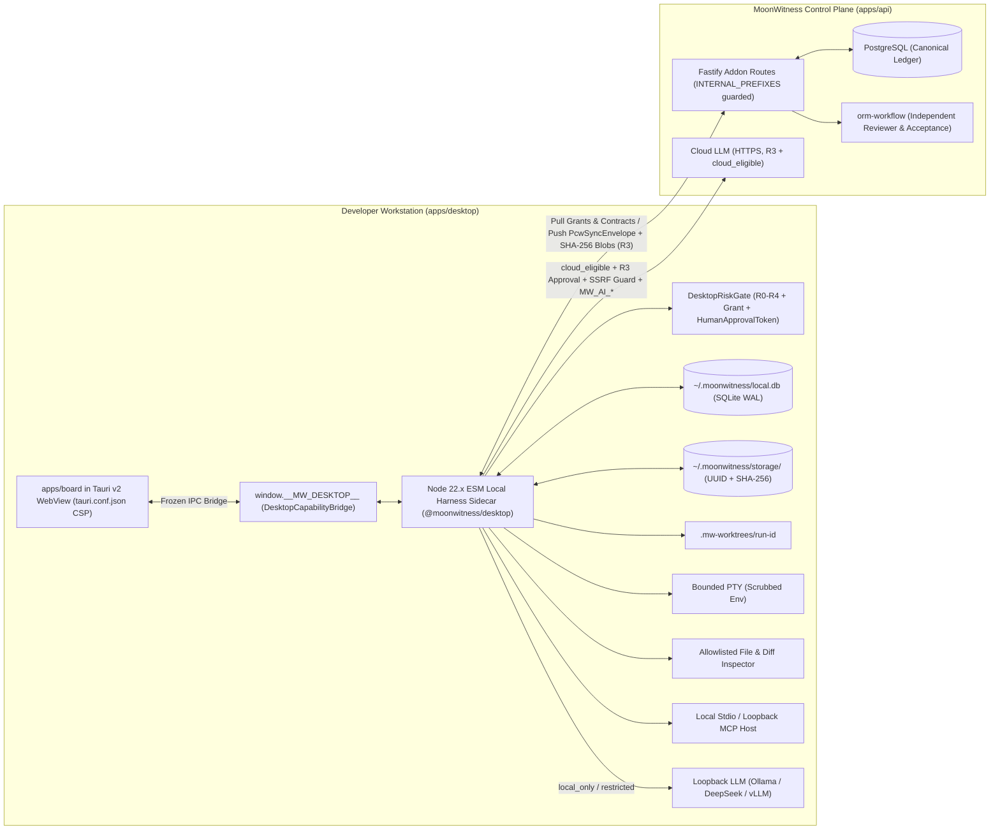

# MoonWitness XV — AI Corporation Local-First Desktop Harness Blueprint

- **Document status:** Accepted Extension to the AI Corporation Blueprint (2026-11-22)
- **Canonical Architecture & ADR:**
  - [ADR 0008: Local-First Desktop Agent Harness](../../docs/architecture/adr/0008-local-first-desktop-agent-harness.md)
  - [Desktop Local-First Harness Architecture](../../docs/architecture/desktop-local-first-harness.md)
  - [Desktop Engineering Checklist (`DSK-0`–`DSK-10`)](../../todo-desktop.md)
- **Blueprint & Roadmap Links:**
  - [AI Corporation Grand Plan](AI-CORPORATION-GRAND-PLAN.md)
  - [AI Corporation Implementation Plan](AI-CORPORATION-IMPLEMENTATION-PLAN.md)
  - [AI Corporation Research Register](AI-CORPORATION-RESEARCH-REGISTER.md)
  - [AI Corporation TODO (`AI0`–`AI11`)](roadmap/todo-ai-corporation.md)
  - [Official ADR 0007](../../docs/decisions/0007-ai-corporation-addon-first-architecture.md)
  - [Canonical Roadmap Cards (`M12.01`–`M12.14`)](../../docs/roadmap/13-ai-corporation.md)

---

## 1. Strategic Role in the AI Corporation Blueprint

In [`AI-CORPORATION-GRAND-PLAN.md`](AI-CORPORATION-GRAND-PLAN.md), MoonWitness XV separates the **Domain Plane** (Addon-First truth in `@moonwitness/orm` + `@moonwitness/orm-ai`) from the **Execution Plane** (bounded agent harnesses, workspaces, tools, and providers). While server-side workers (`apps/api` + `@moonwitness/jobs`) execute centralized, multi-tenant background runs against PostgreSQL, software engineering and local-knowledge operators need a **Local-First Desktop Agent Harness (`apps/desktop`)** that brings Antigravity / Codex Desktop / DeepSeek Harness ergonomics directly to a developer workstation:

1. **Offline & Local-Loopback Autonomy:** Works without internet connectivity using `~/.moonwitness/local.db` (SQLite WAL sidecar) and local loopback inference (`Ollama`, local `DeepSeek`, `vLLM`, `llama.cpp`) while maintaining full `@moonwitness/orm` schema, capability, and audit parity.
2. **True OS Containment:** Gives agents isolated Git worktrees (`.mw-worktrees/run-<id>`), bounded process/PTY verification gated by Risk Tiers `R0–R4` (`DesktopRiskGate`), path-allowlisted file/diff inspection, and local stdio/loopback MCP tool hosting (`@moonwitness/ai-mcp`)—capabilities browsers cannot host natively.
3. **Zero Overlap With `apps/board` & `apps/api`:** `apps/desktop` hosts `apps/board` directly inside a Tauri v2 window (`apps/desktop/tauri.conf.json`) derived from `@moonwitness/ui` + `@moonwitness/assets` and stores durable state using the exact same `@moonwitness/orm-*` addon manifests.

---

## 2. How `apps/desktop` Fits the Five Architectural Bets

Mapping directly onto the five bets in [`EXECUTIVE-SUMMARY.md`](../EXECUTIVE-SUMMARY.md) and [`AI-CORPORATION-GRAND-PLAN.md`](AI-CORPORATION-GRAND-PLAN.md):

| AI Corporation Bet                               | Server / Web Realization (`apps/api` + `apps/board`)                                                                           | Local-First Desktop Realization (`apps/desktop`)                                                                                                                                          |
| ------------------------------------------------ | ------------------------------------------------------------------------------------------------------------------------------ | ----------------------------------------------------------------------------------------------------------------------------------------------------------------------------------------- |
| **1. Addon-First Intelligence**                  | `@moonwitness/orm-ai` + `@moonwitness/orm-*` synchronized to PostgreSQL via `API_ADDONS`                                       | Exact same `@moonwitness/orm-*` addon manifests installed via `installAddons` onto `~/.moonwitness/local.db` (`better-sqlite3`)                                                           |
| **2. Proof-Carrying Work (PCW)**                 | `ai.work_contract`, `ai.acceptance_criterion`, `ai.artifact_manifest` (`sha256`), `orm-workflow` `requireDifferentActor: true` | Local harness emits SHA-256 evidence blobs + `PcwSyncEnvelope` (`ai.agent_run`, `ai.artifact_manifest`, `base.outbox_event`); central `apps/api` verifies digests and controls `accepted` |
| **3. Obligation-Centric Continuity**             | `ai.obligation` tracks ongoing compatibility, test, and source commitments across releases                                     | Local worktree commits and test runs check impacted `ai.obligation` predicates pre-push and emit re-verification artifacts                                                                |
| **4. Adaptive Organization, Fixed Constitution** | Single-company `ai.agent` (`role: 'user'`), `ai.capability_grant`, `ai.execution_policy`                                       | Execution-time `DesktopRiskGate` + `isActiveCapabilityGrant` check before every worktree/PTY/file/MCP call; single-use `HumanApprovalToken` for `R3`; `R4` hard block                     |
| **5. Learning by Measured Consequence**          | `ai.memory_candidate` & `ai.skill_version` remain unpromoted candidates until ablation & human approval                        | Local runs emit candidate episodic/skill proposals tagged with run SHA & verification status; never auto-promoted into local policy                                                       |

---

## 3. End-to-End Local Execution & Sync Topology

---

## 4. Non-Overlap & Dual-Plane Governance Rules

To align `DSK-0`–`DSK-10` with [`AI-CORPORATION-IMPLEMENTATION-PLAN.md`](AI-CORPORATION-IMPLEMENTATION-PLAN.md) (`A0`–`A7`) and [`13-ai-corporation.md`](../../docs/roadmap/13-ai-corporation.md) (`M12.01`–`M12.14`):

1. **Zero UI Duplication (`apps/board` <-> `apps/desktop`):**
   - Mission Control screens (`M12.10` / `/board/ai/*`) are built once in `apps/board` using `@moonwitness/ui` (`pnpm board:ui:check`).
   - `apps/desktop/tauri.conf.json` mounts `apps/board` (`../board/.next/standalone/apps/board`) and exposes `window.__MW_DESKTOP__` (`DesktopCapabilityBridge`). Desktop-specific inspector drawers (worktree diffs, bounded PTY console, local SQLite sync queue, local model health) render via progressive enhancement only when `window.__MW_DESKTOP__` is present.
2. **Zero Schema Duplication (`@moonwitness/orm` Dual-Dialect):**
   - Both `apps/api` (PostgreSQL) and `apps/desktop` (`~/.moonwitness/local.db` SQLite) consume `@moonwitness/orm-base`, `@moonwitness/orm-ai`, `@moonwitness/jobs`, `@moonwitness/orm-workflow`, `@moonwitness/orm-storage`, and `@moonwitness/orm-knowledge`.
   - No desktop-only SQLite table definitions outside workspace addons (`ADR 0006` / `ADR 0007` D2).
3. **Zero Knowledge AI Boundary Violation (`@moonwitness/local-ai`):**
   - K0–K9 research retrieval and suggestion generation stay strictly inside `@moonwitness/local-ai` (`AI_MODE=disabled` default, tool-free).
   - Tool-using coding and operations harnesses execute exclusively through `@moonwitness/ai-runtime` and `@moonwitness/desktop`.
4. **Zero Self-Certification (`BASE.29`):**
   - An offline or online desktop run can produce `ai.agent_run` checkpoints, `ai.artifact_manifest` SHA-256 digests (`PcwArtifactDigest`), and `base.outbox_event` sync payloads (`PcwSyncEnvelope`), but **cannot** transition a central `ai.work_contract` to `accepted`. Acceptance happens solely through deterministic verification + independent `orm-workflow` review (`requireDifferentActor: true`).

---

## 5. Data Sync Protocol & Risk Tier Summary

### 5.1 Outbox-Backed PCW Synchronization

- **Local Transaction Commit:** Every local run step checkpoint, artifact blob write (`LocalFileAttachmentStorage`), and completion envelope commits atomically to `~/.moonwitness/local.db` as a `PcwSyncEnvelope` referencing `ai.agent_run`, `ai.artifact_manifest`, and `base.outbox_event`.
- **Online Reconciliation:** `syncPending(transport)` claims pending envelopes (`syncStatus: 'pending'`), streams evidence blobs to `apps/api`, and posts an idempotent PCW bundle (`envelopeId`, `fencingToken`, `envelopeSha256`, `artifacts`).
- **Conflict & Revocation Handling:** Central `apps/api` validates `companyId`, checks that the `ai.capability_grant` was active and unrevoked, verifies `fencingToken` monotonicity, and recomputes SHA-256 hashes. Failed or tampered payloads transition to `conflict` or `failed` for operator review—never silent overwrite.

### 5.2 Execution Risk Tiers (`R0–R4`) in `DesktopRiskGate`

| Risk Tier | Actions (`DesktopActionKind`)                                                                                                                                    | Human Sign-Off Required                                                                           |
| --------- | ---------------------------------------------------------------------------------------------------------------------------------------------------------------- | ------------------------------------------------------------------------------------------------- |
| **`R0`**  | `repo.read`, `repo.search`, `git.status`, `git.diff`, `sidecar.read`, `mcp.read`                                                                                 | No                                                                                                |
| **`R1`**  | `worktree.create`, `worktree.write`, `worktree.test`, `pty.exec_local`, `mcp.local_write`                                                                        | No (scoped inside `.mw-worktrees/run-<id>`, grant & quota gated)                                  |
| **`R2`**  | `git.commit_local`, `sidecar.sync_local`, `service.local_start`                                                                                                  | Policy-configured (local repo/sidecar boundary only)                                              |
| **`R3`**  | `git.push_remote`, `network.egress`, `cloud.provider_call`, `upstream.sync_push` (plus remote egress commands/URLs)                                              | **Mandatory** (`HumanApprovalToken` single-use scoped to `runId` + `action` + `approvedByUserId`) |
| **`R4`**  | `secret.read`, `system.destructive`, `worktree.escape`, `privilege.escalate` (plus `.env*`, `.git/*`, `.ssh/*`, `*.pem`/`*.key`, `rm -rf /`, `sudo`, `printenv`) | **Unconditionally Blocked** (`RISK_R4_PROHIBITED`)                                                |

---

## 6. Phased Delivery Map (`DSK-0`–`DSK-10` <-> `M12`)

| Desktop Phase | Focus                                                                                                       | Coupled `M12` Dependencies          |
| ------------- | ----------------------------------------------------------------------------------------------------------- | ----------------------------------- |
| **`DSK-0`**   | Architecture freeze, ADR `0008`, blueprint, non-overlap & baseline verification                             | `M12.01`, `M12.02`                  |
| **`DSK-1`**   | `apps/desktop` Tauri v2 (`tauri.conf.json`) + Node `22.x` sidecar scaffold & zero-overlap `apps/board` host | `M12.10` (`@moonwitness/ui` parity) |
| **`DSK-2`**   | Dual-dialect `@moonwitness/orm` SQLite sidecar (`~/.moonwitness/local.db`)                                  | `M12.03` (`@moonwitness/orm-ai`)    |
| **`DSK-3`**   | Outbox PCW sync engine (`ai.agent_run`, `ai.artifact_manifest`, `base.outbox_event` <-> `apps/api`)         | `M12.05`, `M12.07`                  |
| **`DSK-4`**   | `window.__MW_DESKTOP__` (`DesktopCapabilityBridge`) hardened IPC membrane                                   | `M12.10`                            |
| **`DSK-5`**   | Isolated Git worktree manager (`.mw-worktrees/run-<id>`) & patch/diff engine                                | `M12.08` (conflict control)         |
| **`DSK-6`**   | Bounded PTY runner with `R0–R4` (`DesktopRiskGate`) & `ai.capability_grant` enforcement                     | `M12.11`                            |
| **`DSK-7`**   | Path-allowlisted file & diff inspector (traversal, symlink/junction & secret protection)                    | `M12.05`, `M12.11`                  |
| **`DSK-8`**   | Local stdio/loopback MCP host/gateway + `@moonwitness/ai-mcp` integration                                   | `M12.06`                            |
| **`DSK-9`**   | Plan–Execute–Verify harness loop + Ollama/DeepSeek/vLLM loopback & cloud classification routing             | `M12.04`, `M12.07`                  |
| **`DSK-10`**  | Adversarial containment suite, offline/sync chaos drills, packaging, signing & CI gates                     | `M12.11`, `M12.12`, `M12.14`        |
