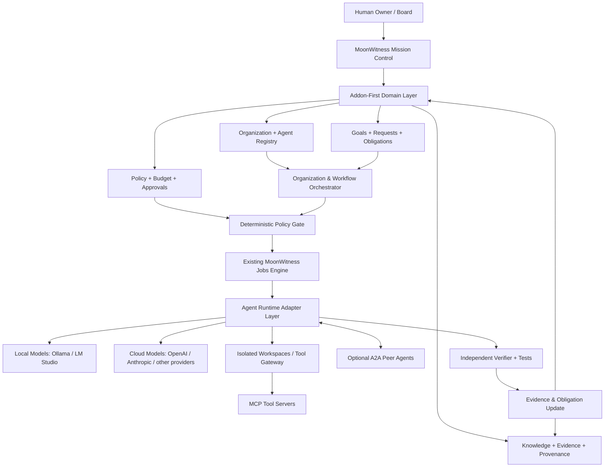

# MOONWITNESS XV — AI CORPORATION
## Grand Plan & Design Blueprint

**Working title:** Evidence-Grounded Adaptive Agent Organization (EGAO)  
**Architecture kernel:** MoonWitness Continuity Kernel (MCK)  
**Document status:** Research-backed proposal; not yet an approved ADR or implementation specification  
**Prepared:** 21 November 2026  
**Repository:** [A-L-L-A-H/mw-xv](https://github.com/A-L-L-A-H/mw-xv)

---

## 0. Executive decision

MoonWitness should evolve into an **evidence-grounded, adaptive AI operating system for long-running projects and organizations**, not become a thin wrapper around an external agent framework and not be replaced by a generic project-management product.

The proposed system has a human-owned company, an adaptive AI workforce, durable task execution, multiple local/cloud model providers, tool and agent interoperability, persistent organizational knowledge, independent verification, and a high-quality Mission Control interface.

The critical design principle is not “more agents.” It is:

> **Every goal becomes a set of accountable obligations; every action is authorized; every result carries evidence; every accepted result remains part of the project's continuing obligations; and every proposed lesson must prove that it improves future work before it is promoted.**

This creates a credible engineering research path toward more general, persistent, self-improving agent systems. It does **not** establish that MoonWitness is AGI, will become AGI, or that any single architecture can guarantee AGI.

### The five architectural bets

1. **Addon-First Intelligence:** all persistent business, organization, agent, policy, execution, and evaluation records are defined through MoonWitness ORM addons. No parallel ORM, shadow database, or duplicated task system.
2. **Proof-Carrying Work:** an agent cannot declare its own work “done.” A work result must include artifacts, acceptance evidence, verification status, provenance, and remaining obligations.
3. **Obligation-Centric Continuity:** accepted work creates obligations that remain active across future sessions and releases. Later changes trigger impact analysis and re-verification of relevant earlier commitments.
4. **Adaptive Organization, Fixed Constitution:** teams and specialists may be composed dynamically, but identity, authority, approval rules, budgets, data boundaries, and safety policies remain deterministic and externally enforced.
5. **Learning by Measured Consequence:** memories, skills, routing rules, and workflow changes are proposed from experience and promoted only after reproducible evaluation. Memory quality is measured by improved future action, not recall alone.

---

## 1. Strategic intent and non-goals

### 1.1 Product intent

MoonWitness XV should support a human directing a persistent organization in which AI agents can:

- understand a declared goal and its constraints;
- inspect the current state of a project and its knowledge;
- propose a plan with dependencies, risks, costs, and acceptance criteria;
- form a task-specific team based on skills and authority;
- execute bounded work through isolated runtimes and approved tools;
- report progress without requiring constant human prompting;
- verify their own work using independent checks;
- preserve the useful history and obligations of previous work;
- learn reusable procedures from success and failure;
- adapt the team structure when the work changes;
- ask a human when ambiguity, risk, or authority requires it.

### 1.2 The AGI direction — stated carefully

The research ambition is to improve measurable ingredients that are relevant to general intelligence in deployed systems: cross-domain task competence, long-horizon planning, causal diagnosis, transfer of experience, uncertainty calibration, adaptation to changing environments, tool use, and coordinated problem solving.

The roadmap should avoid the phrase “AGI achieved.” Instead, it should publish capability levels and reproducible evaluation results. AGI has no single universally accepted operational test, and success on a narrow task benchmark is not evidence of general intelligence.

### 1.3 Non-goals for the first releases

- No autonomous rewriting of production source code, ORM schemas, agent permissions, system prompts, or safety policies.
- No model-weight self-training or online reinforcement learning in the live production system.
- No unrestricted shell, filesystem, network, credential, financial, or publishing access for an agent.
- No agent-created superadmin accounts or privilege escalation.
- No direct LLM writes to PostgreSQL.
- No replacement of the existing Jobs Engine, workflow engine, knowledge ontology, or generic ORM with an external framework.
- No claim that a 3D office visualization proves the existence of real collaboration or intelligence.
- No “exactly once” claims for external effects unless the receiving system and the full transaction boundary prove them.

---

## 2. Repository baseline and constraints

This proposal is aligned with the public repository README and ROADMAP available on 21 November 2026. The public documentation describes MoonWitness as a metadata-driven TypeScript monorepo in which model declarations in addons drive types, validation, tables, relations, access rules, REST/JSON-RPC contracts, and data-driven UI. [S1]

### 2.1 Existing capabilities to reuse

| Existing capability | Role in AI Corporation | Design instruction |
|---|---|---|
| `@moonwitness/orm` / addon installer | Canonical domain model, schema, validation, relation and metadata generation | Extend; do not bypass |
| `orm-organization` | Companies and organization structures | Inspect and reuse before adding org models |
| `orm-request` | Request/work item lifecycle | Determine whether it can be the canonical work item before proposing a new task model |
| `orm-workflow` | Approval and business workflow | Reuse for human gates and state transitions where suitable |
| `orm-notification` | Human/agent notifications | Reuse; add channels only through declared integration boundaries |
| `orm-integration` | External connectors and integration records | Reuse for provider/tool connection metadata if the model contract fits |
| `orm-knowledge`, `knowledge`, `corpus`, `research` | Evidence, source artifacts, assertions, corpus and research workflows | Keep research truth distinct from agent-generated procedural memory |
| `orm-storage` | Artifact and attachment metadata | Store evidence artifact references, not large transient traces in ORM rows |
| `@moonwitness/jobs` | Queue, scheduler, worker, retry, lease, heartbeat, fencing, dead-letter, cancellation, idempotency | Use as the durable dispatch/recovery substrate; extend only when measured gaps exist |
| Auth, audit, outbox, multi-company rules | Identity, isolation and record accountability | Apply to agents as well as human users |
| Board, UI, assets and docs | User experience and visual system | Build a native Mission Control experience from metadata and existing design tokens |

The README specifically documents transactional addon installation, generic REST/JSON-RPC, audit/outbox, multi-company boundaries, and a database-backed Jobs Engine with lease, heartbeat, fencing, retries, dead-letter, cooperative cancellation, and idempotency. [S1]

### 2.2 Existing AI and knowledge work must not be duplicated

The roadmap already contains a K0–K9 “Local AI knowledge rebuild” track. It includes source rights, privacy consent, provenance, assertion/evidence contracts, reviewed decision events, memory/archive ingestion, local-AI runtime boundaries, permission-scoped retrieval, prompt-injection tests, high-risk action isolation, model outage tests, and evidence-backed knowledge workflows. [S2]

Therefore:

- Do **not** build a second evidence/provenance engine.
- Do **not** silently relax the existing tool-free local suggestion runtime so that it becomes an autonomous executor.
- Do **not** merge research claims, source-derived assertions, user stories, and agent procedural memories into one untyped “memory” table.
- Do **not** make the existing local-AI K-track a hidden dependency for agent execution without an explicit ADR.
- Build a separate **workforce execution boundary** that may consume approved knowledge through permission-scoped interfaces.

### 2.3 Repository governance is part of the architecture

The public ROADMAP currently specifies:

- only `main` and `dev` branches;
- `dev` as integration and `main` as stable;
- schema and seed changes through programmatic addon installation/upgrade, not a traditional SQL migration stream;
- additive, idempotent, typed, testable changes;
- no new package or abstraction merely to move code;
- explicit compatibility, evidence, security and promotion gates. [S3]

This blueprint does not authorize a new branch, deployment, or code change. Before implementation, reconcile every proposal against the exact current `dev` SHA, existing task cards, current ADR numbering, and the repository's execution protocol.

### 2.4 Baseline facts versus items requiring fresh verification

**Documented in public README/ROADMAP:** package and domain boundaries, addon-first model declaration, generic API, jobs/outbox capabilities, and the K0–K9 AI/knowledge scope.

**Must be rechecked at the current `dev` SHA before coding:** exact fields and lifecycle of `orm-request`; exact organization membership and role models; addon registration and upgrade extension points; job handler registration contract; local-ai package exports; agent identity/authentication capability; current UI routes/tokens; exact CI state; whether any unmerged work already implements part of this blueprint.

The public web view is not a substitute for a local exact-SHA source audit.

---

## 3. Research synthesis: what the field is teaching us

### 3.1 Multi-agent systems do not improve simply because there are more agents

The 2025 NeurIPS MAST study collected 1,600+ annotated traces from seven multi-agent frameworks and identified 14 failure modes across system design, inter-agent misalignment, and task verification. [R1]

A 2026 orchestration survey distinguishes workflow orchestration (routing agents through a task graph) from organization-level coordination (deciding which agents exist, what roles they hold, and how the organization changes at runtime). It also describes duplication, contradictory outputs, and non-convergent loops as recurring coordination failures. [R2]

**MoonWitness implication:** separate the workflow engine from the organization optimizer. The CEO/planner should not be allowed to redefine the company’s authority model merely because a task is difficult. Dynamic teams are allowed inside a fixed policy envelope.

### 3.2 Long-horizon work needs continuity, not just a longer context window

The 2026 Long-Horizon Software Engineering Agents survey highlights that agents become less reliable when they must build on and maintain their own previous work. It recommends measuring retained functionality and conformance to active requirements, and emphasizes selective revision rather than treating each issue as an isolated task. [R3]

**MoonWitness implication:** a task closed today must not disappear from the future. It may create ongoing obligations such as “API contract remains compatible,” “security test remains passing,” or “this source remains licensed for this use.” A later change should identify and recheck affected obligations.

### 3.3 Memory must change future behavior, not just retrieve old messages

MemoryArena (ICML 2026) evaluates memory across interdependent multi-session tasks and finds that agents that perform well on conversational recall benchmarks can still perform poorly when memory must guide later actions. [R4]

A 2026 preprint on Memory-Centric Continual Learning argues that memory should be assessed by retention under interference, adaptation to change, and task transfer. [R5]

A November 2026 MemUse preprint asks whether a delivered memory was actually used and what effect it had on later actions, rather than only whether retrieval succeeded. [R6]

**MoonWitness implication:** measure memory utility through controlled comparisons: with-memory versus without-memory, task transfer, harmful-memory rate, stale-memory rate, and verified improvement. Do not store every conversation as “learning.”

### 3.4 Tool and agent protocols are complementary

The official MCP `2026-07-28` specification introduced a stateless request/response core and strengthened authorization and routing. MCP is appropriate for exposing MoonWitness data and tools to agents. [R7]

A2A provides the horizontal agent-to-agent layer: an agent can submit a task to another agent, receive status/artifacts, request authorization, and track completion without sharing the remote agent’s internal state. [R8]

**MoonWitness implication:** expose tools through MCP; add A2A only when cross-runtime or external-agent delegation is needed. The internal durable task ledger remains authoritative. MCP or A2A messages are transport, not the system of record.

### 3.5 The most useful GitHub patterns are operational, not cosmetic

The GitHub trend snapshots reviewed on 21 November 2026 show strong recent momentum for SoduWork and LoopForge, while Paperclip remains a high-star AI-company orchestration project. Star counts are activity signals, not proof of quality or production readiness. [G1]

Patterns worth learning from:

- **SoduWork:** acceptance criteria on every request, a separate AI review step, human sign-off, reusable reviewed plugins, multi-harness dispatch, role-based usage and audit. It is in public beta, so evaluate it rather than treating it as a production dependency. [G2]
- **LoopForge:** coding agents in sandboxed workspaces, project roles, checkpoints, history, repeatable SOPs, and approval gates before changes ship. [G3]
- **Paperclip:** company goals, AI employees, reporting hierarchy, budgets, task hierarchy, and scheduled heartbeats. [G4]
- **OpenHands SDK:** a modular software-agent execution layer with local or ephemeral workspaces, including Docker/Kubernetes-style isolated workspaces. Useful as a candidate execution adapter, not as a replacement for MoonWitness domain data. [G5]
- **DeepSeek dsh-superagent:** event-triggered work, an independent work directory/session, a human-facing exception panel, and a principle of acting only when requested or explicitly permitted. The repository warns that it is research code and not production-ready. [G6]

### 3.6 Security is a runtime property, not a prompt

OWASP and government guidance emphasize least privilege, bounded resources, sandboxing, ephemeral credentials, monitoring, explicit action schemas, and deterministic human approval for high-impact actions. Untrusted content can carry indirect prompt-injection instructions. [R9]

**MoonWitness implication:** the model may propose an action, but the policy engine decides whether it is allowed. Never rely on an agent prompt as the security boundary.

---

## 4. Proposed core concept: the MoonWitness Continuity Kernel

### 4.1 The idea

The candidate research contribution is a **Proof-Carrying Continuity Graph** managed by the MoonWitness Continuity Kernel (MCK).

The kernel links five persistent graphs that share typed identifiers and authorization rules:

1. **Organization Graph** — companies, departments, roles, agent identities, capabilities, authority and reporting relationships.
2. **Goal & Obligation Graph** — company goals, project goals, requirements, plans, tasks, dependencies, acceptance criteria and ongoing obligations.
3. **Evidence & Provenance Graph** — observations, source artifacts, claims, provenance, verification records, review decisions and artifacts.
4. **Experience & Memory Graph** — executions, attempts, tool outcomes, lessons, procedures, skills, confidence, expiry and measured utility.
5. **Policy & Authority Graph** — model permissions, tool grants, company boundaries, budgets, risk classes, approval rules and revocation.

This is not a new graph database requirement. The first implementation should use normal relational models and relations declared through existing and new ORM addons. A graph projection or search index may be added later, but it is a derived view, never a second source of truth.

### 4.2 The key novelty hypothesis

Most current agent workspaces concentrate on one of: company hierarchy, task orchestration, tool use, memory retrieval, or coding execution. MoonWitness can test a more integrated proposition:

> **Can a typed, evidence-carrying obligation graph improve long-horizon agent reliability by coupling organizational delegation, proof of work, selective regression checks, and outcome-measured memory updates in one addon-first system?**

This is a research hypothesis, not a verified claim that nobody has ever built it. Prior-art overlap exists across SoduWork, Paperclip, multi-agent frameworks, provenance systems, memory benchmarks, and long-horizon SWE research. A formal novelty review is required before making a “first” or “never done before” claim.

### 4.3 Proof-Carrying Work Package (PCWP)

Every delegated task should have a typed contract that is independent of the model prompt:

```ts
interface WorkContract {
  workId: string;
  parentWorkId?: string;
  objective: string;
  scope: string[];
  nonGoals: string[];
  inputRefs: string[];
  assumptions: Array<{ statement: string; confidence: number }>;
  constraints: string[];
  acceptanceCriteria: Array<{
    id: string;
    description: string;
    verifier: string;
    required: boolean;
  }>;
  allowedCapabilities: string[];
  dataClassification: string;
  riskLevel: 'low' | 'medium' | 'high' | 'critical';
  budgetLimit: number;
  deadline?: string;
}
```

The output is not just a natural-language answer. It is a result envelope containing:

- changed artifacts and immutable artifact references;
- evidence for every required acceptance criterion;
- tests, command summaries, citations or external verification records;
- assumptions that changed and unresolved uncertainty;
- policy version and execution identity;
- any new or modified obligations;
- reviewer decision and human sign-off where required.

The verifier, not the worker, controls the transition to `accepted`.

### 4.4 Obligation-Centric Continuity

When work is accepted, the system records obligations that survive beyond the current task. Examples:

- an API must preserve its published contract;
- a feature must keep its regression tests passing;
- an addon upgrade must remain additive and idempotent;
- a knowledge record must retain source rights and provenance;
- an external integration must keep its credential scope and tenant boundary;
- a release must preserve its security and operational requirements.

Each obligation has:

- stable ID and version;
- type and scope;
- active/superseded/expired state;
- owner (human, team or agent role);
- evidence references;
- verification procedure and last verified result;
- dependencies and invalidation triggers;
- review interval or event trigger where applicable.

When a new change intersects an obligation’s dependency scope, the system opens an impact-review task and reruns the relevant checks. This is the central mechanism for selective revision.

### 4.5 Evidence before confidence

Every important decision should distinguish:

- observed fact;
- source-backed assertion;
- model-generated hypothesis;
- inference;
- policy rule;
- human decision;
- verified outcome.

A model confidence score is not evidence. Agent-generated claims must not be promoted into trusted knowledge without the existing evidence and review pipeline.

---

## 5. Target architecture

### 5.1 System layers



### 5.2 Domain plane versus execution plane

**Domain plane (persistent and governed):** ORM models, addon manifests, goals, requests, teams, agents, policies, budgets, approval records, evidence references, memory candidates, obligations, and verified outcomes.

**Execution plane (ephemeral and isolated):** provider calls, model context, shell sessions, browser sessions, tool processes, sandbox workspaces, transient buffers and high-volume traces.

The domain plane owns the truth. The execution plane receives short-lived, scoped capabilities and reports typed results back through authenticated services.

### 5.3 Addon-First package strategy

The following is a provisional package map, subject to an exact source audit:

| Proposed boundary | Responsibility | Reuse rule |
|---|---|---|
| Existing `orm-organization` | Company, teams, departments, memberships and organizational relationships | Extend only if required by real agent membership semantics |
| Existing `orm-request` | Canonical request/work item, acceptance criteria and assignment if supported | Do not introduce a second `task` model without proving the current model cannot serve |
| Existing `orm-workflow` | Approval states, transitions, escalation and sign-off | Reuse for human gates |
| Existing `orm-integration` | External provider/tool connection metadata | Store secret references, never raw credentials |
| Existing `orm-knowledge` / `knowledge` / `corpus` / `research` | Trusted facts, source artifacts, evidence and provenance | Extend contracts; do not duplicate evidence graph |
| Proposed `orm-ai` addon | Agent definitions, model profiles, capabilities, execution policy references, logical run/delegation records, memory candidates and obligation links where no existing model fits | First inspect existing addon boundaries; start as one cohesive addon, split only when ownership requires it |
| Proposed `ai-runtime` package | Provider adapters, agent harness adapters, planning/delegation services, execution controller and typed result envelopes | No schema ownership; use ORM services and Jobs contracts |
| Proposed `ai-mcp` package/app entry | MCP server that exposes approved MoonWitness operations as tools/resources/prompts | Tool list derived from allowed domain operations; no new data authority |
| Proposed `ai-evaluation` workspace | Deterministic tests, benchmark runners, replay and scoring | Keep benchmark artifacts outside production business tables unless summaries are needed |

Do not create all of these packages immediately. First deliver a dependency and ownership matrix. Avoid package fragmentation.

### 5.4 ORM and persistence rules

- All durable business state is declared through `defineModel` and `defineAddon`.
- Use existing model IDs and relations where their domain meaning is correct.
- New addon manifests must include dependencies, models, views/menus, access metadata, safe seeds, docs, upgrade hooks where needed, and tests according to repository conventions.
- Schema evolution remains programmatic and additive under the existing ORM installer contract.
- Destructive or semantically breaking changes require an explicit compatibility and recovery plan.
- Secrets are references to a secret store/environment binding, not secret strings in model fields, audit records, prompts or logs.
- Do not expose `base.job`, cron definitions, internal run state, audit internals or privileged workflow records through generic CRUD merely because a model exists. Use purpose-built authorized actions.
- Heavy raw traces, model payloads and large artifacts should live in bounded external/object storage with retention and redaction; ORM stores the metadata, digest, access policy and references.

---

## 6. Agent cognition and company operating model

### 6.1 Agent lifecycle

A standard agent run follows this observable lifecycle:

1. **Orient:** load authorized company state, current goal, active obligations, task contract and relevant evidence.
2. **Interpret:** identify ambiguity, assumptions, missing inputs and risk class.
3. **Plan:** produce one or more candidate plans with dependencies, cost and expected verification steps.
4. **Allocate:** choose a worker/team based on capability, context, availability, model suitability, budget and authority.
5. **Authorize:** deterministic policy service issues a scoped, expiring capability token.
6. **Execute:** Jobs Engine dispatches a durable run to an isolated runtime.
7. **Observe:** collect structured outcomes, artifacts, events and environmental changes.
8. **Verify:** deterministic checks and an independent reviewer test the acceptance criteria.
9. **Reconcile:** compare new state against active obligations and prior accepted work.
10. **Consolidate:** propose a memory/skill/policy update from the outcome; evaluate before promoting.

Persist structured decisions, assumptions, evidence and action summaries. Do not depend on hidden model chain-of-thought as system state or audit evidence.

### 6.2 Organization: stable constitution, adaptive teams

Use two distinct graphs:

- **Constitutional graph:** human owner, company boundaries, permanent roles, policy ownership, approval authority, budget caps and security responsibility. Changes require deterministic authorization.
- **Operational graph:** temporary departments, project teams, specialist agents, delegated work and collaboration links. This graph may adapt under policy.

Start with a small default workforce:

| Role | Responsibility | Default authority |
|---|---|---|
| CEO / Planner | Interpret company goals, propose plans and allocate work | May delegate within company and budget limits; cannot change constitutional policy |
| Operations Manager | Schedule work, monitor queues and escalate blockers | Manage low-risk internal workflow |
| Research Specialist | Gather and synthesize source-backed evidence | Read approved sources; propose assertions, never self-approve them |
| Architect | Design technical approach and interface contracts | Read repository; propose ADRs and plans |
| Builder | Implement bounded code or content changes | Write only in isolated workspace/assigned repo scope |
| QA / Reviewer | Independently verify artifacts and acceptance evidence | Read artifacts and tests; no silent approval of own work |
| Security Reviewer | Review permissions, dependencies and high-risk changes | Read-only security inspection; may block/escalate |

An adaptive organization may spawn temporary specialists (e.g. database reviewer, accessibility auditor, localization expert) for a defined task. Each temporary role needs an owner, capabilities, expiry, budget and decommission condition.

### 6.3 Delegation policy

The manager does not broadcast every message to every agent. It routes a structured work contract to the smallest qualified group. Agents exchange artifacts and typed messages rather than long unfiltered transcripts.

Delegation is permitted only if:

- the parent agent has authority to delegate the requested scope;
- the target agent is enabled and has the required capabilities;
- the task’s data classification is permitted for the target model/provider;
- the budget and concurrency quotas allow the work;
- the task has verifiable acceptance criteria;
- no circular delegation or unresolved duplicate task exists.

A delegation graph must detect cycles, duplicate active assignments, conflicting writes and runaway re-delegation. A parent run is not complete until child outputs are reconciled and verified.

---

## 7. The learning and memory architecture

### 7.1 Separate five memory types

| Memory | What it stores | Promotion rule |
|---|---|---|
| Working state | Current task context, plan, scratch results | Short retention; not trusted as durable fact |
| Episodic memory | What happened in a run, including failures and recovery | Append-only summary with references to evidence |
| Semantic knowledge | Source-backed claims and domain facts | Existing knowledge/provenance review pipeline |
| Procedural memory | Reusable skills, SOPs, tool procedures and checklists | Versioned, tested, scoped and reviewed |
| Normative memory | Policies, boundaries, definitions and approved operating rules | Only authorized human/governance changes |

Do not let an agent turn an episode into semantic truth without provenance and review. Do not let procedural memory override normative policy.

### 7.2 Two-loop improvement

**Inner loop — task experience:** observe outcome, record evidence, diagnose failure, propose a lesson, attach applicable task classes and confidence.

**Outer loop — controlled learning:** replay candidate lessons against a benchmark corpus, compare baseline and candidate, evaluate transfer and regression, then promote or reject a version.

A memory item is useful only if it improves future decision or execution quality. Record whether it was retrieved, used, contradicted, stale, harmful, redundant or useful. Support expiry and supersession; forgetting and revocation are first-class operations.

### 7.3 Skill and SOP library

A reusable skill should be a versioned operational contract, not a free-form prompt blob. It contains:

- purpose and supported task types;
- required inputs and expected outputs;
- steps and tool requirements;
- risk class and permission needs;
- acceptance criteria and test method;
- example traces with rights/provenance;
- owner, version, compatibility and deprecation status;
- benchmark results and known failure modes.

Agent-generated changes become candidates; no agent may silently publish its own skill for all departments.

---

## 8. Provider, tool and protocol interoperability

### 8.1 Model provider abstraction

Implement a stable provider contract independent of the database models:

- provider discovery/health;
- model capabilities and context metadata;
- request/response streaming;
- tool-call format normalization;
- cancellation and deadline propagation;
- token/cost usage;
- retry classification;
- structured output validation;
- data residency/classification declaration.

Support local and cloud providers through adapters. Keep the existing restricted local knowledge-suggestion runtime isolated; a new general agent runtime must be a separately reviewed execution boundary.

**Routing policy:** choose the cheapest acceptable model that meets capability, latency, privacy, reliability and budget constraints. Escalate to a stronger model only when needed and allowed. Cloud fallback must never happen automatically for a data class that requires local execution.

### 8.2 MCP for tools

MCP exposes approved domain operations to compatible agents and clients. Tool definitions should be generated or declared from the same domain service contracts and access metadata as MoonWitness, not reimplemented as a second business API.

Start with read-only tools, then low-risk reversible writes, then selected high-risk operations behind approvals. Use the official authorization model, request validation, rate limits, audit and output redaction. Support the `2026-07-28` stateless protocol architecture through a well-defined adapter rather than coupling the domain model to one MCP version.

### 8.3 A2A for peer agents

Add A2A only when MoonWitness needs task delegation across different runtimes or organizations. A2A handles agent-to-agent task exchange; MCP handles agent-to-tool operations. Both should map back to MoonWitness internal request/run/evidence identifiers.

### 8.4 Runtime and sandbox adapters

Define a harness adapter interface so MoonWitness can use multiple execution environments without binding its domain to one vendor:

- internal bounded tool runner for safe non-code actions;
- local CLI harness adapter where permissions permit;
- ephemeral Docker workspace for coding agents;
- OpenHands Agent Server/SDK adapter as a candidate for software tasks;
- remote worker adapter only after secrets, network and tenant isolation are certified.

A model provider and an agent harness are different things: the provider generates model outputs; the harness manages the agent loop, tools, workspace, events and execution. Do not confuse the two.

---

## 9. Trust, governance and security model

### 9.1 Least agency

Each agent receives only the minimum capabilities, resources, data and duration required for its assigned task. Default is no write action, no shell, no external network and no credential. Capability grants expire and are revoked after execution.

### 9.2 Risk tiers

| Tier | Examples | Default policy |
|---|---|---|
| R0 — Observe | Read allowed metadata, inspect approved documents | Autonomous |
| R1 — Reversible internal | Draft task, propose plan, create private note, run read-only tests | Autonomous within quota |
| R2 — Scoped write | Modify isolated branch/workspace, create draft PR, update assigned records | Autonomous with constraints and audit |
| R3 — External or consequential | Send messages, publish content, alter production settings, change permissions, spend beyond small cap | Explicit human approval |
| R4 — Irreversible / critical | Delete production data, disclose secrets, financial transfer, change root security or company ownership | Human-only; never autonomous |

Risk classification is enforced by deterministic service logic, not by the model's self-assessment.

### 9.3 Required controls

- Agent identity is not a human login and is never a superadmin account.
- Every agent has a unique principal, company scope and revocable capability set.
- Tool policy checks occur server-side immediately before each effect.
- Run credentials are short-lived, scope-bound and not present in prompts.
- Sandbox filesystem, process, network, CPU, memory, time and output are bounded.
- Untrusted issue text, webpages, documents and tool outputs are treated as data, not instructions.
- High-risk actions require workflow approval and human-visible diffs.
- Secrets, prompts, sensitive personal content and raw provider payloads are redacted from logs by default.
- Audit events record who/what initiated the action, policy version, tool, target, approval and result.
- Kill switch can pause one agent, one company, one provider, a tool class or the complete workforce.

### 9.4 Threat model

The threat model must cover prompt injection, indirect injection, data exfiltration, confused deputy, malicious tool descriptions, dependency compromise, agent identity spoofing, cross-company leakage, budget exhaustion, runaway loops, silent partial failure, duplicate external effects, reviewer collusion, memory poisoning, and unsafe autonomous policy changes.

---

## 10. Reliability and operations

### 10.1 Use the existing Jobs Engine first

The current Jobs Engine already documents leases, heartbeats, fencing tokens, retries/backoff, dead-letter, cancellation, idempotency and outbox behavior. Reuse it for durable dispatch and wakeups. Do not introduce Temporal or another workflow database immediately.

Before choosing a new durable-execution system, benchmark whether the existing engine can support:

- long-running agent runs with checkpoints;
- resume after process/host/provider restart;
- waiting for human approval without holding a worker lease;
- streaming event references and cancellation;
- bounded fan-out/fan-in;
- compensation or recovery for partially completed external actions;
- deterministic replay where applicable.

If these requirements exceed the engine, record an ADR and compare an external durable workflow engine as an execution adapter, not as a second source of task truth.

### 10.2 Run state machine

Suggested logical lifecycle (map to current job/request/workflow enums after audit):

`draft → triaged → planned → awaiting_plan_approval → queued → leased → running → awaiting_input | awaiting_action_approval → verifying → accepted → closed`

Terminal/exception states include `failed`, `cancelled`, `blocked`, `superseded`, `rejected` and `expired`.

A “completed” model output is not an accepted work item. A result must pass deterministic checks and the assigned approval policy.

### 10.3 Recovery requirements

- Idempotency key per external effect.
- Checkpoint at safe boundaries, not after every token.
- Lease and fencing token validation before committing state.
- Explicit distinction between retryable, permanent and negative business outcomes.
- Dead-letter inspection and operator replay controls.
- Parent/child run recovery and orphan detection.
- Graceful shutdown and provider-outage circuit breaking.
- Backup/restore drills covering run references, artifacts and obligations.

### 10.4 Observability

Adopt OpenTelemetry GenAI semantic conventions for agent invocation, planning, inference, retrieval and tool execution where practical. Use traces to connect a user goal → plan → job → agent run → model call → tool call → artifact → verifier → obligation update.

Store summarized run metadata, policy decisions and evidence references in ORM. Place high-volume traces in an observability store with redaction, access controls and retention. Never use user IDs or other high-cardinality private identifiers as metric labels.

---

## 11. Mission Control UX and visual direction

The UI should feel like a premium operations console for a living organization, but remain usable as a serious ERP/workspace. Visual polish must communicate state and accountability, not hide them behind animation.

### 11.1 Primary views

1. **Company HQ:** company goals, org chart, departments, agent roster and operating status.
2. **Workforce:** agent profile, role, capabilities, model, current run, budget, reliability, memory/skill versions and access grants.
3. **Mission Control:** request backlog, plan graph, dependencies, active work, blocked work, review queue and deliverable timeline.
4. **Live Operations:** event stream, run detail, tool-call timeline, token/cost use, retries, errors, provider health and queue state.
5. **Evidence & Continuity:** source/provenance inspector, acceptance checklist, obligation graph, regression results, decisions and superseded evidence.
6. **Governance & Finance:** policy editor, capability grants, approvals, budget limits, spend forecasts, audit search and emergency pause.
7. **Research & Learning Lab:** skill registry, memory candidates, eval results, A/B comparisons, drift and promotion history.

### 11.2 Visual design rules

- Native MoonWitness design tokens, assets, type, spacing and accessibility rules.
- Premium dark mode plus complete light mode; no dark-only workflows.
- Org chart and task graph must also have accessible list/table alternatives.
- Status colors must be semantic and consistent; avoid decoration that looks like operational state.
- Live activity should be readable and filterable, not a noisy ticker.
- Motion is subtle and respects reduced-motion preferences.
- A 3D office/campus may be an optional “ambient view” after the core 2D/accessible views are reliable. It is visualization only and must never become the canonical state surface.
- UI forms and views derive from addon metadata where the current Board architecture supports it; specialized interactive visualizations use explicit typed client contracts.

---

## 12. Research contribution and path toward more general capability

### 12.1 Candidate research contribution

**Working research thesis:** an addon-first agent organization that couples (a) typed organizational authority, (b) evidence-carrying work contracts, (c) a persistent obligation graph, and (d) outcome-measured procedural memory may improve the reliability of multi-session, multi-agent projects compared with task-only orchestration.

### 12.2 Candidate experiments

- **E1 — Obligation continuity:** compare a task-only agent workflow with one that stores and rechecks obligations after every accepted change.
- **E2 — Proof-carrying work:** compare self-reported completion against acceptance-criteria evidence plus an independent verifier.
- **E3 — Dynamic organization:** compare fixed-role teams against capability-based temporary teams under equal token/tool budgets.
- **E4 — Memory usefulness:** compare no memory, retrieval memory, procedural memory, and outcome-gated memory on dependent multi-session tasks.
- **E5 — Disagreement preservation:** measure whether a reviewer system preserves minority evidence and corrects premature consensus.
- **E6 — Selective broadcast:** compare all-agent broadcast with capability-based publish/subscribe routing for cost, latency and missed-critical-information.
- **E7 — Recovery:** inject crashes, provider timeouts, stale leases, duplicated outbox deliveries, invalid tool output and interrupted approvals.
- **E8 — Cross-domain transfer:** test whether skills learned in software tasks help with research, documentation, data analysis or operations without unsafe overgeneralization.

### 12.3 The “AGI staircase” as measurable engineering maturity

| Level | Capability | Evidence required |
|---|---|---|
| G0 — Governed assistant | Read, summarize, retrieve and propose | Permission tests, provenance correctness, calibrated uncertainty |
| G1 — Bounded actor | Complete one scoped task using tools | Acceptance tests, action audit, safe sandbox |
| G2 — Persistent worker | Resume multi-session work and preserve obligations | Crash recovery, task continuity, retained functionality |
| G3 — Coordinated team | Delegate, review and combine agent outputs | Reduced duplicate work, verifiable handoffs, cost controls |
| G4 — Adaptive organization | Compose temporary teams and routing policies | Better outcomes than fixed baseline without policy violations |
| G5 — Experience-driven improvement | Reuse skills/memory and improve future outcomes | Controlled ablation, transfer, retention, rollback and no safety regression |
| G6 — Cross-domain generalist research system | Handle unfamiliar task families with limited human decomposition | Broad external evaluation, robust uncertainty, transfer and independent replication |

These levels are product/research milestones, not accepted scientific definitions of AGI.

---

## 13. Evaluation framework

A system that cannot prove its quality should not be trusted with more autonomy.

### 13.1 Core metrics

| Metric | Definition | Why it matters |
|---|---|---|
| Verified task success | Required acceptance criteria passed / required criteria | Avoids self-reported completion |
| Retained functionality | Previously accepted active obligations that still pass / eligible previously accepted obligations | Detects regressions in continuing projects |
| Requirement conformance | Current active requirements satisfied / total active requirements | Detects drift from current goals |
| Evidence completeness | Required criteria with valid evidence / required criteria | Measures auditability |
| Evidence validity | Evidence independently confirmed / submitted evidence | Detects fabricated or irrelevant proof |
| Duplicate work rate | Duplicate active work items / active work items | Measures coordination quality |
| Contradiction rate | Outputs that conflict on shared facts / outputs reviewed | Measures alignment |
| Recovery success | Recoverable interrupted runs resumed without corrupting state / recoverable interruptions | Measures resilience |
| Unsafe-action rate | Unauthorized or policy-violating effects | Target zero in release gates |
| Memory utility | Difference in downstream outcome with and without selected memory | Tests actual learning value |
| Memory harm rate | Later failures attributable to stale/wrong memory | Prevents memory poisoning |
| Cost per accepted result | Model + runtime + tool cost / accepted deliverable | Makes autonomy economically governable |
| Human interruption burden | Human interventions per accepted project milestone | Measures whether autonomy reduces work rather than creating review toil |

### 13.2 Test corpus

Create synthetic and owner-approved test projects that cover:

- long-running software development with changing requirements;
- knowledge research with source rights and citation requirements;
- content production with provenance and publication approval;
- data analysis with reproducibility and calculation checks;
- operations tasks with reversible versus irreversible effects;
- cross-session memory with conflicting or superseded facts;
- agent team changes, provider outages, injected instructions and tool failures.

Do not use sensitive user or witness material as evaluation data without the required consent, rights and privacy review already specified by the K-track.

### 13.3 Release gates

- No critical authorization bypass or cross-company leakage.
- No secret/token exposure in prompts, outputs, logs or artifacts.
- No unauthorized external effects in adversarial tests.
- All R3/R4 test cases must stop for required approval or human-only handling.
- Every closed work item must have a verifier result and required evidence.
- Recovery must not create duplicate external effects under injected crash tests.
- Memory promotion must not reduce safety or regression metrics.
- All addon installs/upgrades must pass idempotency, compatibility and rollback/recovery tests.
- Every performance and reliability claim must link to exact SHA, fixture, environment and run evidence.

---

## 14. Phased delivery strategy

The project should move in evidence-gated phases, not a large “build all agents” rewrite.

### Phase 0 — Exact-SHA audit and architecture freeze

Deliver:
- current `dev` source inventory;
- reuse matrix for existing addons and jobs;
- local-ai/K-track boundary review;
- current ADR/task/roadmap cross-reference;
- threat model and data classification;
- baseline test, runtime and provider measurements.

Exit: maintainer-approved ADR and no duplicate domain ownership.

### Phase 1 — Agent domain foundation (Addon-First)

Deliver:
- minimal agent, model profile, capability and policy metadata;
- agent identity and company-scoped authorization mapping;
- safe provider secret-reference contract;
- dynamic Board views for agent registry and model profiles;
- addon conformance and tenant isolation tests.

Exit: an agent may be registered and inspected but cannot perform privileged actions.

### Phase 2 — One durable, bounded agent

Deliver:
- provider adapters for one local and one cloud route;
- one deterministic safe task class;
- Jobs Engine integration;
- run state and structured result envelope;
- read-only and low-risk tool set;
- independent verifier and human-visible evidence.

Exit: after forced crash/provider outage, the task resumes or reaches an auditable terminal state without duplicate effects.

### Phase 3 — Proof-Carrying Work and Obligation Ledger

Deliver:
- typed acceptance criteria;
- evidence envelope and verifier contract;
- persistent obligation records or an extension to existing domain models;
- invalidation triggers and selective rechecks;
- dashboard for obligations and regression status.

Exit: a later change detects and re-verifies at least one previously accepted obligation.

### Phase 4 — Multi-agent team and adaptive organization

Deliver:
- CEO/planner, builder, reviewer and researcher roles;
- bounded delegation and dynamic team assembly;
- dependency and cycle detection;
- selective event subscriptions;
- cost/concurrency limits;
- approval and escalation flow.

Exit: a multi-step project completes with traceable task ownership, independent review, no duplicate assignment and correct budget enforcement.

### Phase 5 — Memory and procedural learning

Deliver:
- episodic and procedural memory contracts;
- memory candidate review/versioning/expiry;
- controlled A/B evaluation and replay;
- transfer tests across related task families;
- rollback for harmful memory/skill releases.

Exit: a memory/skill release improves an independently evaluated future task set without safety regression.

### Phase 6 — MCP and A2A interoperability

Deliver:
- authenticated MCP server with read-only first and bounded write scopes;
- tool catalog generated from authorized domain operations;
- optional A2A adapter for remote peer-agent delegation;
- protocol conformance tests, audit and revocation.

Exit: external agents can safely inspect/delegate to MoonWitness within tenant and policy boundaries.

### Phase 7 — Mission Control and research lab

Deliver:
- premium Company HQ, Workforce, Mission Control, Live Operations, Evidence & Continuity, Governance, and Research Lab views;
- accessible graph/list alternatives;
- real-time updates and observability correlation;
- reproducible benchmark reports.

Exit: the operator can understand who is doing what, why, with which permissions, at what cost, and what evidence proves completion.

### Phase 8 — Generalization research

Deliver:
- cross-domain benchmarks;
- unfamiliar-task evaluation;
- memory and team adaptation studies;
- failure analysis and independent replication package;
- public research note with limitations.

Exit: publish measurable results, including negative results. No AGI claim by milestone completion.

---

## 15. Key architecture decisions proposed

1. MoonWitness remains the system of record; external agent platforms are adapters or research references.
2. ORM Addon-First is mandatory for durable domain state.
3. Existing `orm-request`, `orm-workflow`, `orm-organization`, `orm-knowledge` and `@moonwitness/jobs` are reviewed for reuse before new schema is introduced.
4. The existing knowledge/research AI runtime remains separate from general agent execution.
5. The first autonomous release has one bounded worker and an independent verifier; the organization graph comes later.
6. The worker never approves its own high-risk action or final acceptance.
7. MCP is the tool/data protocol; A2A is optional peer-agent protocol; Jobs/ORM remain the internal durable source of truth.
8. No live self-modification. Skill, memory and policy updates are versioned proposals evaluated offline.
9. All autonomous actions are least-privilege, time-bound, company-scoped and auditable.
10. Use the existing Jobs Engine until measurements demonstrate a specific missing durable-execution capability.

---

## 16. Main risks and countermeasures

| Risk | Failure mode | Countermeasure |
|---|---|---|
| Architecture duplication | New AI subsystem duplicates request/workflow/knowledge/jobs | Exact reuse matrix and ADR before schema work |
| Multi-agent overhead | More tokens, slower results, more contradictions | Start single-agent; recruit only when task decomposes; measure net benefit |
| Supervisor bottleneck | CEO makes one bad decomposition that poisons the team | Independent plan critique, worker feedback, replanning and human escalation |
| Memory poisoning | A wrong result becomes permanent policy | Candidate-only memory, provenance, replay and promotion gate |
| Stale obligations | Old requirements persist after scope changes | Active/superseded status, explicit owner and change impact review |
| Prompt injection | Untrusted content changes agent goals or tool use | Treat content as data; policy gate outside model; least agency |
| Tool privilege creep | Agent obtains excessive durable credentials | Ephemeral scoped capability tokens and revocation |
| Cost runaway | Heartbeats, retries and parallel workers consume budget | Global/agent/task budgets, concurrency caps, hard stop and alerting |
| False completion | Agent claims success without working evidence | Independent verifier and evidence completeness gate |
| Model lock-in | Provider changes break workflow or model-specific prompts | Provider abstraction, contract tests and model capability registry |
| UI theater | Beautiful dashboard hides poor reliability | UI state must be backed by real runs, evidence and tests |
| AGI overclaim | Narrow benchmark gains presented as general intelligence | Explicit capability levels, broad evaluation and transparent limitations |

---

## 17. Immediate next actions

The next code-facing task should **not** be to build the CEO agent. It should be to approve this architecture direction and perform Phase 0 against the exact `dev` SHA.

Recommended first outputs:

1. A source-backed reuse matrix for existing addon models and services.
2. A formal ADR covering domain boundaries, agent identity, memory boundaries, tool policy and runtime separation.
3. A threat model and capability/risk matrix.
4. A minimal data-contract proposal for one agent and one execution run.
5. An executable proof-of-concept: one local/cloud model adapter, one queued task, one isolated safe action, one independent verifier, one evidence record, one recovery test.

Only after this should the team create the first implementation task cards and update the master roadmap. The new AI workstream must not silently change existing M/K-series statuses or break the two-branch governance model.

---

## 18. Decision requested from maintainers

Approve or reject these strategic choices before implementation:

- MoonWitness is the only business/source-of-truth plane.
- All durable AI/company entities remain ORM Addon-First.
- The existing K0–K9 knowledge track remains authoritative for source truth, provenance, privacy and local suggestion safety.
- General-purpose AI workforce execution is a separate, explicitly permissioned runtime.
- The first proof point is one bounded durable agent with verified output, not a large agent swarm.
- The central research bet is Proof-Carrying Continuity: accepted outputs create obligations; future work preserves and rechecks them; experience only becomes memory after outcome-based evaluation.

**Recommendation:** approve the direction as a research and architecture program, not as a claim of AGI or as immediate authorization to implement all phases.

---

## References

See [`AI-CORPORATION-RESEARCH-REGISTER.md`](../research/AI-CORPORATION-RESEARCH-REGISTER.md) for the full evidence register and notes on relevance/limitations.

- [S1] MoonWitness README and architecture, public repository snapshot: https://github.com/A-L-L-A-H/mw-xv
- [S2] MoonWitness Master Roadmap, especially K0–K9: https://github.com/A-L-L-A-H/mw-xv/blob/main/ROADMAP.md
- [S3] MoonWitness addon/API compatibility policy: https://github.com/A-L-L-A-H/mw-xv/blob/main/docs/engineering/compatibility.md
- [R1] Cemri et al., “Why Do Multi-Agent LLM Systems Fail?”, NeurIPS 2025: https://proceedings.neurips.cc/paper_files/paper/2025/hash/b1041e52d3be19f0a9bc491657488e4a-Abstract-Datasets_and_Benchmarks_Track.html
- [R2] “LLM-Based Multi-Agent Orchestration: A Survey of Frameworks, Communication Protocols, and Emerging Patterns,” Future Internet, 2026: https://www.mdpi.com/1999-5903/18/6/326
- [R3] Luo et al., “Long-Horizon Software Engineering Agents: From Tasks to Projects,” 2026: https://longhorizonswe.github.io/
- [R4] He et al., “Benchmarking Agent Memory in Interdependent Multi-Session Agentic Tasks,” ICML 2026 / PMLR 306: https://proceedings.mlr.press/v306/he26am.html
- [R5] Li et al., “Memory-Centric Continual Learning for AI Agents,” arXiv:2610.29357, 21 Oct 2026: https://arxiv.org/abs/2610.29357
- [R6] Xu et al., “Delivered, Not Used: Evaluating Agent Memory at Its Point of Use,” arXiv:2611.01718, 1 Nov 2026: https://arxiv.org/abs/2611.01718
- [R7] Model Context Protocol, 2026-07-28 specification: https://blog.modelcontextprotocol.io/posts/2026-07-28/
- [R8] A2A protocol specification: https://a2a-protocol.org/latest/specification/agent-card/
- [R9] OWASP DevSecOps AI Agent and MCP Security: https://owasp.github.io/DevSecOpsGuideline/2-Process/2-2-Develop/2-2-5-AI-Agent-and-MCP-Security/
- [G1] GitHub AI-agent trend snapshot, 15–21 Nov 2026: https://upstar.dev/t/ai-agents
- [G2] SoduWork: https://github.com/mdiri-ai/SoduWork
- [G3] Tencent LoopForge: https://github.com/Tencent/LoopForge
- [G4] Paperclip core concepts: https://github.com/paperclipai/paperclip/blob/master/docs/start/core-concepts.md
- [G5] OpenHands Software Agent SDK: https://github.com/OpenHands/software-agent-sdk
- [G6] DeepSeek dsh-superagent prototype: https://github.com/deepseek-ai/dsh-superagent-prototype
- [O1] OpenTelemetry GenAI agent/tool semantic conventions (development status): https://github.com/open-telemetry/semantic-conventions-genai
